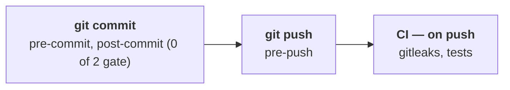

# Dev Setup

How my machine and my Claude Code agents are set up. Lives at `~/ws/dev-setup`.

## Machine

- [Maccy](https://maccy.app/) — clipboard manager
- [Rectangle](https://rectangleapp.com/) — window management
- Shell config is in `zsh/`. Install: `echo 'source ~/ws/dev-setup/zsh/.zshrc' > ~/.zshrc` -- a
  stub, so edits in `zsh/` are live and installers that append to `~/.zshrc` don't touch the repo.
- VS Code user config is in `vscode/`: saving trims trailing whitespace and ends the file in one
  newline, and `Cmd+T` opens the terminal. Install by linking, so edits made in VS Code land here:
  `ln -sf ~/ws/dev-setup/vscode/{settings,keybindings}.json ~/Library/Application\ Support/Code/User/`
  On a new laptop: clone this repo to `~/ws/dev-setup`, open VS Code once so that directory
  exists, then run the `ln` — it needs no admin rights, and it replaces any settings already
  there. To confirm where VS Code keeps them, run "Preferences: Open User Settings (JSON)" from
  the Command Palette and right-click the tab → Reveal in Finder.
  On a machine whose own settings must stay (a work laptop), merge instead of linking:
  `python3 ~/ws/dev-setup/scripts/vscode_merge.py` adds these to the files already there and
  keeps the rest. Run it again after a `git pull`; see the script's docstring for the rules.

## Conventions

| Path | What it is | Where to edit |
| --- | --- | --- |
| `global-claude/CLAUDE.md`, `global-claude/settings.json` | Copies of my global `~/.claude` config | `~/.claude` — `global-claude/sync.sh` (a `Stop` hook) copies changes here and commits them |
| `global-claude/skills/` | My global skills (`/commit`) | Here — link them in: `mkdir -p ~/.claude/skills; for s in ~/ws/dev-setup/global-claude/skills/*; do ln -sfn "$s" ~/.claude/skills/; done` |
| `.claude/` | This repo's own project config (`plans/`), same as any project | Here |

On a new laptop, link the global `CLAUDE.md` rather than copying it:
`mkdir -p ~/.claude && ln -sf ~/ws/dev-setup/global-claude/CLAUDE.md ~/.claude/CLAUDE.md`
Claude Code reads it there, and so does Copilot Chat in VS Code when `chat.useClaudeMdFile` is
on. A linked file is edited in this repo directly, so `sync.sh` has nothing to copy — commit it
by hand.

A project's own `CLAUDE.md` holds only what's specific to it — ports, build command, tests.

## Enforcement

Agent guards: Claude Code hooks that statically check every Bash command and every edit an
agent makes, so it builds and tests the documented way (through `docker compose`, never `npm
install` on the host) and commits in small batches. They live in
[`landing-page`](https://github.com/buedaswag/landing-page) (`scripts/guards/`, README "Agent
guardrails"), the only repo that uses them, and may be deprecated.

## Secret leak gate

gitleaks (Docker, pinned), via `scripts/secret_scan.sh`. Enable with `git config core.hooksPath .githooks`.

- **`.githooks/pre-commit`** scans the work tree and reports. It never blocks a commit.
- **`.githooks/pre-push`** scans every commit not yet on the remote and blocks the push on a
  finding. It also blocks when the scan can't run (no Docker).

Tests: `python3 -m unittest discover tests/`

## Pipeline

<!-- pipeline:start -->

Generated from the hooks and workflows. Full detail: [`docs/pipeline.md`](docs/pipeline.md).

Shape, in text

<!-- pipeline:end -->

## Backlog: Refactor Along the Way

Known and deliberately not done yet. Each one gets picked up the next time I'm in that file.

- **Retire the `SessionStart` `cp` in `~/.claude/settings.json`.** It copies skills out of
  `interview-prep` and `CV` into `~/.claude/` on every session start — the direction this repo's
  mirroring deliberately reverses, and it's ungated.
- **Package the pipeline diagram.** Make it a `pyproject.toml` package with a `pipeline-diagram`
  entry point that depends on PyYAML. It gets installed at a pinned version in each repo's CI,
  replacing the copied `scripts/pipeline_*.py`. Do it when a third repo copies the files, or the
  first time two copies drift. Until then, deploying means `cp`.
