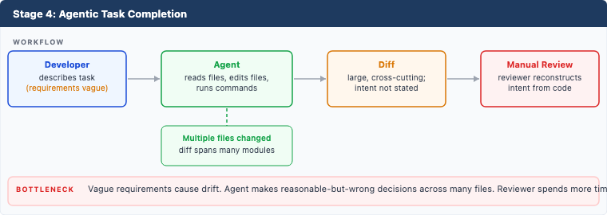
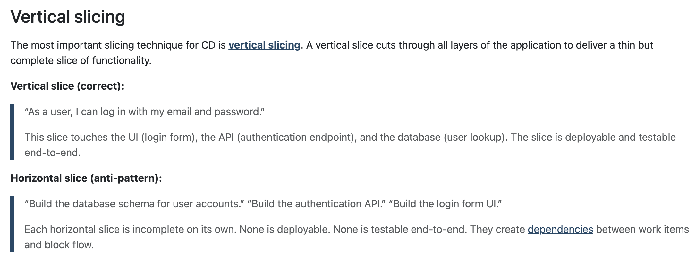
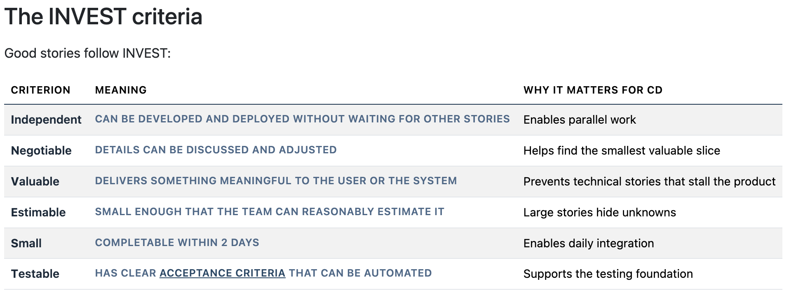

# Developing software with Agents

Based on Bryan’s Agentic CD.

I'm summarizing his content, definitely reccomend opening all the links and reading the articles.

## Starting point - how we are developing

https://beyond.minimumcd.org/docs/agentic-cd/getting-started/learning-curve/



We’re learning how to write software with agents

One agent at a time:

1. Write desired outcome + hypothesis + spec
    - https://beyond.minimumcd.org/docs/optimize/hypothesis-driven-development/
    - tldr: **“We believe [change] will produce [outcome] because [reason].”**
2. Loop:
   - ATDD basic paragraph - https://beyond.minimumcd.org/docs/optimize/small-batches/#atdd-connecting-scenarios-to-daily-integration
    - tldr:
        1. Pick one BDD scenario.
        2. Write the acceptance test first.
        3. Write just enough code to pass.
        4. Refactor.
        5. Commit and integrate.
        6. Repeat.
3. Continue until feature satisfies spec
4. Review against desired outcome + hypothesis

## The minimal artefacts we need to write code

### CLAUDE.md

- what? example: docs/ACD/assets/CLAUDE.md
- Where to keep it?
  - ~/.claude/CLAUDE.md (stuff that applies to all repos)
  - or
  - Repo root (specific to one repo)
  - Or at the claude root file if you’re working in multiple terraform repositories for example
    - For example if you work in terraform modules that all have roughly the same structure, and way to test, then specify that here

TODO - put this link in the references and add a link to the references line here
learn more: Section - Configuration mechanisms - https://beyond.minimumcd.org/docs/agentic-cd/getting-started/agent-setup/

### hooks

- The two you'll most likely have:
  - **pre-commit** - runs before the commit, reports but never blocks (commit is a local save point; pre-push/CI are the gates). Ex: unit tests
  - **post-commit** - runs after the commit exists, can't block anything. Ex: security checks, doc updates, lint fixes

`.githooks/pre-commit`

```bash
#!/bin/bash
# Report, never block: a non-zero exit here would abort the commit.
python -m unittest discover tests || echo "Tests FAILED -- commit allowed, fix before pushing." >&2
exit 0
```

`.githooks/post-commit`

```bash
#!/bin/bash
# Runs after the commit. Its exit code changes nothing, so it only reports
# and fixes. Any fixes land in the working tree for the next commit or an amend

echo "Security checks..."
pip-audit                 # known vulnerabilities in dependencies
bandit -r src/ -q         # insecure code patterns

echo "Docs..."
python scripts/update_docs.py

echo "Lint fixes..."
ruff check --fix .
ruff format .

git diff --quiet || echo "post-commit changed files. Review and commit them." >&2
```

Install them (once per clone):

```sh
mkdir -p .githooks                          # hooks live in the repo, so they're versioned and shared
chmod +x .githooks/pre-commit .githooks/post-commit
git config core.hooksPath .githooks         # point git at them instead of .git/hooks
```

### Skills

- Very cool way to work using agents is shown in section Skills - https://beyond.minimumcd.org/docs/agentic-cd/getting-started/agent-setup/ and complete definition of each skill here - https://beyond.minimumcd.org/docs/agentic-cd/architecture/agent-configuration/#skills
- The minimal ones are
  - Start-session
  - Review
  - end-session
TODO (me): explore whats a minimal way to get this set up

### Agent Delivery Contract or spec (now it gets interesting, and HAS NOTHING TO DO WITH AI!!)

“If your specification effort for a single change takes more than 15 minutes, the change is too large. Split it.”
- Story or scenario too big? See [Slicing strategies](#slicing-strategies)

TODO: instead of going through both articles in paralel (one contains the examples, the other the prompts to create the example sections, merge the two and. put them here - in a separate doc containing just the full spec (take from here - https://beyond.minimumcd.org/docs/agentic-cd/specification/first-class-artifacts/#2-user-facing-behavior) + one doc per section containing that section of the spec from before, plus the prompts to use to refine it that bryan has here https://beyond.minimumcd.org/docs/agentic-cd/specification/agent-assisted-specification/)
https://beyond.minimumcd.org/docs/agentic-cd/specification/first-class-artifacts/#2-user-facing-behavior

Single .md containing

- Intent description (+ hypothesis)
    - "Your scenarios should describe the intended behaviour of the system, not the implementation. In other words, it should describe what, not how."
        - TODO add this to the references - https://cucumber.io/docs/bdd/better-gherkin/
- User-facing behavior (behavior-driven development - BDD)
- Feature description (architecture decisions, implementation details - the weeds)
- Acceptance criteria (written as observable outcomes, not internal implementation details)
- System constraints
  - Stuff u have not already defined in claude.md

### Slicing strategies

**CONCERN:** how do we enforce that the batches of work stay small?

https://beyond.minimumcd.org/docs/foundations/work-decomposition/

- tldr: when a story feels too big, apply one of these strategies:
  - By workflow step - implement one step of a multi-step process
  - By business rule - implement one rule at a time
  - By data variation - handle one data type first
  - By operation - implement CRUD operations separately
  - By performance - get it working first, optimize later
  - By platform - support one platform first
  - Happy path first - implement the success case first

The most important (and nuanced) slicing strategy:

    TODO: just slap this bitch on the doc.

TODO just slap this table here and bold the meaning col


(see loop above in Starting point - how we are developing)
"How to structure agent sessions so context stays manageable, commits stay small, and the pipeline stays green" - https://beyond.minimumcd.org/docs/agentic-cd/architecture/small-batch-sessions/
- Tldr: we implement and integrate one BDD scenario at a time (see bellow - Agent Delivery Contract or spec)

## Lessons learned from applying this in practice

- Work slicing was hard. The spec got way too big: ~250 lines, and it took 2 to 3 hours to build instead of the 15 minutes Bryan mentions.
- pair programming is tables stakes: this will result in massive code changes, so build the spec with your colleague.
    - TODO (me): add at least a sectioon about pair programming etiquete?

## References

- Overview of the ACD workflow
  - Section - The ACD workflow in https://beyond.minimumcd.org/docs/agentic-cd/
- Bryan’s talk at devopsdays Dallas, Texas https://www.youtube.com/watch?v=8u_FVTRtqrw

## Next up:

- DONE review what i have against what claude gave me
- Try it out
  - Create a new repo and feature request
  - Write the feature
  - Document learnings
- Improve this documentation
  - Missing at least a quick mention to TDD
  - Work decomposition needs a tldr + some good/bad examples from our team context
    - https://beyond.minimumcd.org/docs/foundations/work-decomposition/
